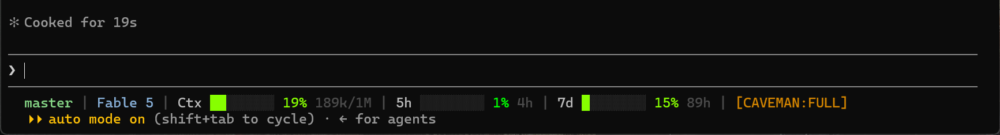

# claude-statusline

Status line for Claude Code:



Renders, in one line:

- **Git branch** of the current workspace (omitted outside a repo; short SHA when detached)
- **Model** display name
- **Ctx** — context-window usage as a green→yellow→red bar with percentage and `used/total` tokens
- **5h / 7d** — session rate-limit usage bars with time-until-reset
- **[CAVEMAN:MODE]** indicator when the caveman plugin's mode flag is active

## Files

| File | Purpose |
|------|---------|
| `pr-statusline.ps1` | The status line script; Claude Code pipes session JSON to it on stdin |
| `Install.ps1` | Points `statusLine` in Claude Code's `settings.json` at the script |

## Install

```powershell
.\Install.ps1
```

Updates the `statusLine` entry in `settings.json` (in `$env:CLAUDE_CONFIG_DIR`, defaulting to `~\.claude`), preserving all other settings. If `settings.json` doesn't exist yet (Claude Code never started), the installer skips with a message — start Claude Code once and re-run. Idempotent. After moving this repo, re-run it: the entry references the script by absolute path.

## Test

Feed it a sample payload:

```powershell
'{"model":{"display_name":"Test"},"context_window":{"used_percentage":42}}' | powershell -File .\pr-statusline.ps1
```
