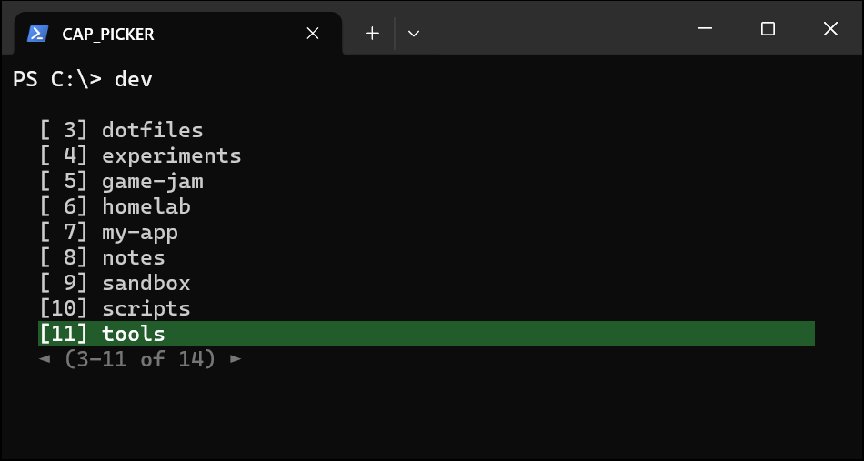
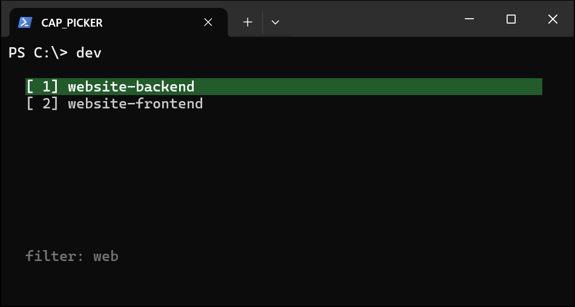

# PowerShell profile

PowerShell profile providing a shortcut to launch `claude` in a project: pick a folder under your dev root and Claude Code starts there. The root defaults to `C:\DEV`; override it by setting `$env:DEV_ROOT`.



## What it does

- **`dev [folder]`** (alias: **`agent`**) — jump to a project folder under the dev root and launch `claude` there.
    - `dev` with no argument opens an interactive picker (arrow keys, type-to-filter, `1`-`9` quick select, `Esc` to cancel).
    - `dev util` with a partial name suggests matching folders; a single match asks `Y/n`, multiple matches open the picker pre-filtered.
    - Subfolders work too: `dev proj/back` matches inside `C:\DEV\proj`, and `dev proj/` opens the picker on that folder's subfolders.
    - Tab completion on the folder argument, including nested paths (`dev proj/ba[tab]`).
    - A bare name also matches folders inside `~Cerbrus` (`dev card` finds `~Cerbrus\card-scanner`); the picker lists them after the top-level folders.
- **herdr auto-start** — inside a terminal [herdr](https://herdr.dev) pane, the profile launches `claude` when the pane is the only one in its tab, so new workspaces and tabs open as Claude sessions while splits stay plain shells. The Herdr desktop app is not covered; see [herdr-config](../herdr-config/README.md) for that. Set `$env:DEV_NO_AUTO_CLAUDE` to turn it off.
- **`Select-DevFolder`** — the reusable console picker behind `dev` (scrolling viewport, filter status line).

Type-to-filter narrows the list as you type:



## Install

Run the installer (no admin required):

```powershell
.\Install.ps1
```

It detects the installed PowerShell editions (Windows PowerShell 5.1 always; PowerShell 7+ if `pwsh` is found) and, for each one, writes a stub profile that dot-sources the repo file — so this repo stays the single source of truth. It is idempotent: an existing dot-source line (or a symlink already pointing at the repo profile) is left alone, and a profile with other content gets the dot-source line appended rather than overwritten.

### Manual alternative: symlink

If you prefer a symlink, run this from an **elevated** PowerShell (symlink creation requires admin unless Developer Mode is enabled):

```powershell
New-Item -ItemType SymbolicLink -Path $PROFILE -Target 'C:\DEV\~Cerbrus\utilities\powershell-profile\Microsoft.PowerShell_profile.ps1' -Force
```

`$PROFILE` differs per PowerShell edition — run the command in each edition you use:

- Windows PowerShell 5.1: `C:\Users\<user>\Documents\WindowsPowerShell\Microsoft.PowerShell_profile.ps1`
- PowerShell 7+: `C:\Users\<user>\Documents\PowerShell\Microsoft.PowerShell_profile.ps1`

## Verify

```powershell
Get-Content $PROFILE   # should show (or dot-source) the repo profile
. $PROFILE             # reload in current session
dev                    # picker should appear
```
