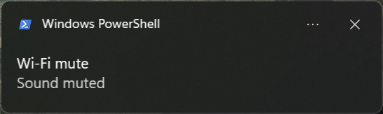

# wifi-mute

Automatically mutes/unmutes the laptop when connecting to specific Wi-Fi networks.

Which networks mute and which unmute is configured per machine in `networks.json` — any number of SSIDs is supported. For example:

- Connect to **WorkNetwork** → sound muted
- Connect to **HomeNetwork** → sound unmuted



## How it works

- Windows logs event **8001** to `Microsoft-Windows-WLAN-AutoConfig/Operational` on every Wi-Fi connect (including resume-from-sleep reconnects).
- One scheduled task per network triggers on that event, filtered on SSID via an XPath subscription, and runs `Set-Mute.ps1`.
- `Set-Mute.ps1` toggles the default playback device through the CoreAudio COM API (`IAudioEndpointVolume`) using inline C# — no external tools or modules.
- The tasks pass `-Notify 1`, showing a silent toast ("Sound muted" / "Sound unmuted") via the WinRT toast API. The toast appears as sent by "Windows PowerShell" (borrowed AUMID) and is suppressed while Do Not Disturb / Focus Assist is active (still lands in the Action Center).

## Files

| File | Purpose |
|------|---------|
| `Set-Mute.ps1` | Mutes (`-Mute 1`) or unmutes (`-Mute 0`) the default playback device; `-Notify 1` shows a toast |
| `Install.ps1` | Registers the scheduled tasks from `networks.json`; prompts for networks on first run (or with `-Reconfigure`) |
| `networks.json` | Machine-specific network list (not committed, git-ignored); created by `Install.ps1` |

## Configuration

`networks.json` lives next to the scripts and is a JSON array of `{ssid, mute}` entries:

```json
[
  { "ssid": "WorkNetwork", "mute": true },
  { "ssid": "HomeNetwork", "mute": false }
]
```

You can edit it by hand and re-run `Install.ps1`, or regenerate it interactively with `.\Install.ps1 -Reconfigure`.

## Install

Run as your own user (no admin needed):

```powershell
.\Install.ps1
```

On first run (no `networks.json` yet) the script prompts interactively: enter an SSID, then whether to **m**ute or **u**nmute when connecting to it; repeat for as many networks as you like and press Enter on an empty SSID to finish (at least one network is required). The answers are saved to `networks.json` and the tasks are registered.

On later runs the existing `networks.json` is used as-is; pass `-Reconfigure` to be prompted again.

Re-running is idempotent — all existing `WiFi Mute - *` / `WiFi Unmute - *` tasks are removed first and re-created from the config, so networks removed from `networks.json` are cleaned up too. After moving this repo, re-run it: tasks reference the script by absolute path.

## Test

Trigger the tasks manually without switching networks (using the example SSIDs above):

```powershell
Start-ScheduledTask 'WiFi Mute - WorkNetwork'    # sound should mute
Start-ScheduledTask 'WiFi Unmute - HomeNetwork'  # sound should unmute
```

Or run the script directly: `.\Set-Mute.ps1 -Mute 1`

## Uninstall

Remove all wifi-mute tasks in one go:

```powershell
Get-ScheduledTask -TaskName 'WiFi Mute - *', 'WiFi Unmute - *' | Unregister-ScheduledTask -Confirm:$false
```

## Notes & limitations

- Only the **default** playback device is muted. Switching output devices after the event keeps the new device's own mute state.
- Tasks run as the logged-on user, non-elevated; nothing happens when nobody is logged in.
- The tasks reference `Set-Mute.ps1` by absolute path (`C:\DEV\utilities\wifi-mute\`).
- `-ExecutionPolicy Bypass` in the task action applies to that single invocation only.
